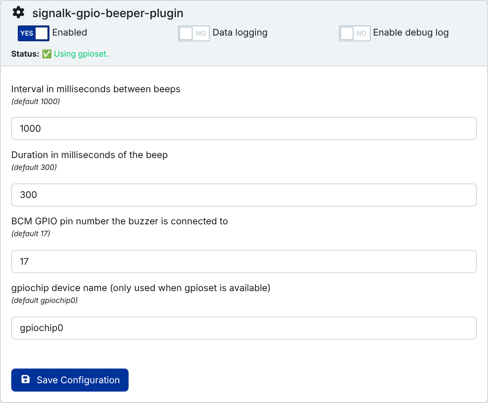
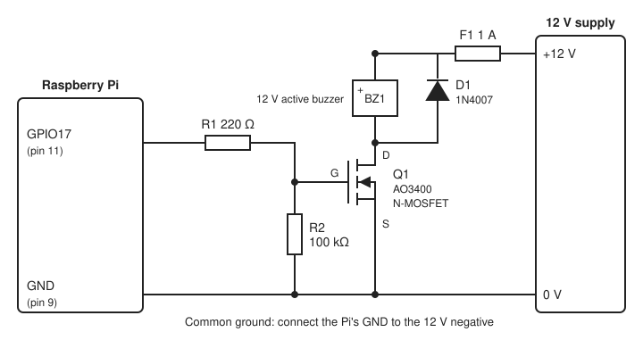

# Signal K GPIO Beeper Plugin

A [Signal K](https://signalk.org/) plugin that activates a piezo beeper attached to the Raspberry Pi GPIO header when a Signal K notification alarm condition exists (e.g. anchor dragging, etc).

The plugin checks notifications on the configured interval (default 1 sec), and if any "**emergency**", "**alarm**", or "**warn**" notifications exist, it will beep the beeper for the configured duration.

The plugin will ignore notications that do not have:

    method: ["sound"]

and it will ignore notifications that have:

    status: {
        silenced: true
    }

The plugin assumes you are using an "active" beeper (no PWM required) attached to GPIO 17 (BCM numbering) by default.

## Wiring

The beeper must be an "active" one, with its own oscillator, so that it sounds on plain DC.

A GPIO pin gives 3.3 V and only a few milliamps, and it must never see more than 3.3 V. A small 3.3 V piezo that draws very little current can sit directly between the pin and GND. Anything louder, such as a 12 V buzzer on the boat's supply, needs a transistor between the pin and the buzzer. This low-side MOSFET switch is one way to do that:

| Part | Value                                      | Why                                                                                                        |
| ---- | ------------------------------------------ | ---------------------------------------------------------------------------------------------------------- |
| Q1   | logic-level N-channel MOSFET, e.g. AO3400  | Fully on at a 3.3 V gate. A MOSFET that needs 10 V on its gate (IRF540, IRFZ44N) barely conducts at 3.3 V. |
| R1   | 220 Ω                                      | Limits the current that charges the gate.                                                                  |
| R2   | 100 kΩ, gate to GND                        | Keeps the buzzer off while the Pi boots and the pin is not driven yet.                                     |
| D1   | 1N4007 across the buzzer, cathode to +12 V | Takes the voltage spike when an electromagnetic buzzer switches off. Harmless with a piezo buzzer.         |
| F1   | 1 A fuse                                   | Protects the wiring from the boat's 12 V supply.                                                           |

Connect the Pi's GND to the 12 V negative, or the MOSFET has no reference for the gate voltage. No 12 V ever reaches the Pi.

A relay module works as well, if it is opto-isolated and specified to switch on a 3.3 V input; many cheap modules need 5 V.

## Prerequisites

This plugin controls GPIO without any native addon dependencies, so it works with Signal K App Store installs (which run `npm install --ignore-scripts`).

It prefers [`gpioset`](https://manpages.debian.org/testing/gpiod/gpioset.1.en.html) (from the `gpiod` / `libgpiod-tools` package) to control the GPIO pin, and falls back to raw sysfs GPIO if `gpioset` isn't found. `gpioset` is required for Raspberry Pi 5 / CM5, since those boards have removed sysfs GPIO entirely.

- **Raspberry Pi OS Bookworm and later (including Pi 5):** `gpioset` is installed by default. Nothing to do.
- **Older releases (Buster, some Bullseye images):** you may need to install it manually:

      sudo apt update
      sudo apt install gpiod

  Verify it's available with `which gpioset`.

If `gpioset` isn't found, the plugin automatically falls back to sysfs GPIO. This works on older Pi models but **not on Pi 5 / CM5**. Check the plugin status in the Signal K admin UI to see which implementation is active.

## Configuration

### Interval

Number of milliseconds between checking notifications and issuing a beep if warranted (default is 1000 milliseconds).

### Duration

Beep duration in milliseconds (default is 300 milliseconds).

### GPIO Pin

The BCM GPIO pin number the buzzer is connected to (default is 17).

### GPIO Chip

The `gpiochip` device name to use, e.g. `gpiochip0` (default). Only used when `gpioset` is available; ignored when falling back to sysfs.

## Testing your wiring

You can trigger a manual test beep without needing to raise a real alarm, by visiting (or curling) this URL while the plugin is running:

    http://<your-signalk-host>:3000/plugins/signalk-gpio-beeper-plugin/test

This beeps for 5 seconds by default. To use a different duration, add a `seconds` query parameter (0.5–30):

    http://<your-signalk-host>:3000/plugins/signalk-gpio-beeper-plugin/test?seconds=0.5

The response text confirms which GPIO implementation (`gpioset` or `sysfs`) was used, which is a quick way to check what your device fell back to.
